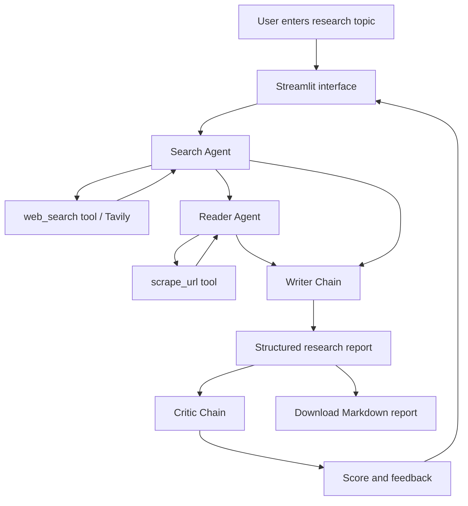

<div align="center">

# 🔬 ResearchMind

### Multi-Agent AI Research System

**An LLM-powered research workflow for web discovery, content extraction, report writing, and critical review.**

Built with **Python · LangChain · LangGraph · Groq · Tavily · Streamlit**

[Features](#-features) · [Architecture](#-system-architecture) · [Quick Start](#-quick-start) · [How It Works](#-how-it-works) · [Troubleshooting](#-troubleshooting)

</div>

---

## 📖 Overview

**ResearchMind** is a multi-stage, agentic research application that helps turn a research topic into a structured report. Instead of relying on a single LLM response, it orchestrates a sequence of four specialized components:

1. **Search Agent** — searches the web for relevant information.
2. **Reader Agent** — retrieves detailed content from a selected source URL.
3. **Writer Chain** — synthesizes the gathered material into a research report.
4. **Critic Chain** — evaluates the draft and provides a score and constructive feedback.

The application provides a **Streamlit** interface for submitting a topic, viewing intermediate outputs, and downloading the generated report as Markdown.

> **Scope:** This is a sequential research pipeline with two tool-enabled agents and two LLM chains. It is not a multi-agent group chat or a vector-database RAG system.

## ✨ Features

- **Topic-driven research** through a simple web interface.
- **Tool-enabled web search** using a search tool backed by Tavily (as configured in `tools.py`).
- **URL-based content extraction** through a dedicated reader/scraping tool.
- **LLM orchestration** with LangChain agents and runnable chains.
- **Structured report generation** with an introduction, key findings, conclusion, and sources section.
- **Automated critique** that returns a score, strengths, areas for improvement, and a one-line verdict.
- **Pipeline visibility** with Search, Reader, Writer, and Critic status cards, plus expandable intermediate outputs.
- **Markdown export** of the completed research report.
- **Groq-hosted LLM inference**, configured through the `ChatGroq` integration.

## 🧠 System Architecture



### Component Responsibilities

| Component | Implementation | Responsibility | Output |
|---|---|---|---|
| **Search Agent** | LangChain `create_agent` + `web_search` | Discover and summarize relevant web sources | Search findings and source references |
| **Reader Agent** | LangChain `create_agent` + `scrape_url` | Choose a relevant URL and extract deeper page content | Extracted page information |
| **Writer Chain** | `ChatPromptTemplate` → `ChatGroq` → `StrOutputParser` | Combine search findings and extracted content into a report | Markdown-compatible research report |
| **Critic Chain** | `ChatPromptTemplate` → `ChatGroq` → `StrOutputParser` | Assess report quality and identify improvements | Numerical score and written feedback |

**Orchestration detail:** `app.py` invokes the four stages in sequence. LangChain's `create_agent` uses LangGraph internally for the agent execution loop; the application does **not** define a custom LangGraph `StateGraph`.

## 🛠️ Technology Stack

| Layer | Technology | Purpose |
|---|---|---|
| Language | **Python** | Core application and integration logic |
| Agent framework | **LangChain** | Tool-enabled agents and LLM chains |
| Agent execution | **LangGraph** | Underlying execution framework for LangChain agents |
| LLM provider | **Groq API** via `langchain-groq` | Model inference |
| Search | **Tavily Search API** | Web discovery |
| Web extraction | **Requests, BeautifulSoup** | Page fetching and HTML parsing, depending on `tools.py` |
| Frontend | **Streamlit** | Research input, pipeline status, results, and export |
| Configuration | **python-dotenv** | Load local API keys from `.env` |
| Output parsing | **StrOutputParser** | Convert writer and critic LLM outputs to strings |

## 📁 Project Structure

The key files used by the application are:

```text
Multi-agent-research-system-main/
├── app.py               # Streamlit UI and sequential pipeline
├── agents.py            # Search/Reader agents and Writer/Critic chains
├── tools.py             # web_search and scrape_url tool implementations
├── requirements.txt     # Python dependencies
├── .env                 # Local API keys (do not commit)
└── README.md            # Project documentation
```

> Other files may be present in your repository. The structure above shows the main components referenced by the supplied code.

## 🚀 Quick Start

### Prerequisites

- **Python 3.11+** recommended (use a version supported by your installed dependencies).
- A **Groq API key**.
- A **Tavily API key** if your `web_search` implementation requires Tavily.
- An internet connection to reach the LLM, search, and source websites.

### 1. Clone the Repository

```bash
git clone https://github.com/YOUR_USERNAME/YOUR_REPOSITORY.git
cd YOUR_REPOSITORY
```

Replace the placeholders with the actual repository URL, or open the project folder directly if it is already on your computer.

### 2. Create and Activate a Virtual Environment

**Windows PowerShell**

```powershell
python -m venv .venv
.\.venv\Scripts\Activate.ps1
```

**macOS / Linux**

```bash
python3 -m venv .venv
source .venv/bin/activate
```

### 3. Install Dependencies

```bash
python -m pip install -r requirements.txt
```

Ensure `requirements.txt` includes the packages used by the current implementation, especially:

```text
streamlit
langchain
langchain-core
langchain-groq
langgraph
python-dotenv
tavily-python
requests
beautifulsoup4
```

Exact search-tool dependencies may differ according to the contents of `tools.py`.

### 4. Configure API Keys

Create a `.env` file at the project root:

```dotenv
GROQ_API_KEY=your_groq_api_key
TAVILY_API_KEY=your_tavily_api_key
```

Groq keys are managed in the [Groq Console](https://console.groq.com/keys); Tavily keys are available from [Tavily](https://tavily.com/).

**Never commit `.env` or real API keys to GitHub.**

Recommended `.gitignore` entries:

```gitignore
.env
.venv/
__pycache__/
*.py[cod]
.streamlit/secrets.toml
```

### 5. Start the Application

```bash
python -m streamlit run app.py
```

Streamlit normally serves the app at **http://localhost:8501**.

## 🔄 How It Works

### Step 1 — Search Agent

The user submits a topic. The search agent receives a request to find recent, reliable, detailed information and can invoke the registered `web_search` tool. Its output becomes the input context for the next stage.

### Step 2 — Reader Agent

The reader agent receives the topic and a shortened portion of the search output (the application passes up to the first **800 characters** of the search result). It can use the registered `scrape_url` tool to access a selected source and extract additional context.

### Step 3 — Writer Chain

The writer receives both the search findings and the reader output. Its prompt requests:

- **Introduction**
- **Key Findings** (at least three explained points)
- **Conclusion**
- **Sources** (URLs found in the supplied research)

The chain uses `ChatPromptTemplate`, the configured Groq model, and `StrOutputParser`.

### Step 4 — Critic Chain

The critic assesses the generated report and returns a structured evaluation:

```text
Score: X/10

Strengths:
- ...
- ...

Areas to Improve:
- ...
- ...

One line verdict:
...
```

**Note:** The critic provides feedback; the current code does not automatically revise the report based on that feedback.

## 🖥️ User Interface

The Streamlit app includes:

- **Research Topic** input field and **Run Research Pipeline** button.
- **Four pipeline status cards** for the Search, Reader, Writer, and Critic stages.
- Expandable **raw search results** and **scraped content** panels.
- A rendered **Final Research Report** section.
- A **Critic Feedback** section.
- A **Download Report (.md)** control.

## ⚙️ Model Configuration

The model is initialized in `agents.py` with `ChatGroq`. For example, the original code shared for this project used:

```python
from langchain_groq import ChatGroq

llm = ChatGroq(
    model="openai/gpt-oss-120b",
    temperature=0,
)
```

You can change the `model` identifier to another **model currently available on your Groq account** that supports tool calling. Availability and free-tier limits can change; consult [Groq's model documentation](https://console.groq.com/docs/models) before switching.

The same `llm` instance is used for both tool-enabled agents and the Writer/Critic chains.

## 🧩 Implementation Details

### LangChain Agents

```python
from langchain.agents import create_agent

# Search Agent
create_agent(model=llm, tools=[web_search])

# Reader Agent
create_agent(model=llm, tools=[scrape_url])
```

Each agent receives **only its registered tools**. If the model tries to call a tool that is not provided, the provider may reject the request.

### Prompt-Driven LLM Chains

```python
writer_chain = writer_prompt | llm | StrOutputParser()
critic_chain = critic_prompt | llm | StrOutputParser()
```

This design keeps report generation and quality review as separate, reusable runnable chains.

## 🔧 Troubleshooting

| Issue | Likely Cause | What to Check |
|---|---|---|
| `ModuleNotFoundError: langchain_groq` | Package missing from active environment | Run `python -m pip install langchain-groq` |
| `groq.APIConnectionError` / `getaddrinfo failed` | DNS or network connectivity | Run `nslookup api.groq.com` and check HTTPS connectivity |
| `groq.BadRequestError: tool_use_failed` | Model attempted to call an unregistered tool | Verify actual tool names in `tools.py`, agent prompts, and model tool-calling behavior |
| Missing API key | `.env` not configured or loaded | Confirm `GROQ_API_KEY` / `TAVILY_API_KEY` and `load_dotenv()` |
| Streamlit command not found | Package missing or wrong environment | Run `python -m streamlit run app.py` |
| Scraping produces no useful content | Site restrictions, dynamic content, or changed markup | Check the URL, response status, and `scrape_url` tool behavior |

## ⚠️ Current Limitations

- **Sequential execution:** the next stage waits for the previous one to complete.
- **No checkpoint-based recovery:** an unhandled exception can interrupt the pipeline; resuming from a failed stage is not implemented in the supplied app.
- **Single-source deep reading:** the reader is prompted to pick the most relevant URL rather than systematically scrape every returned source.
- **Limited context transfer:** the reader receives up to 800 characters of the search result in the current `app.py`.
- **No automatic revision loop:** critic feedback is displayed, not fed back to the Writer Chain.
- **Source quality depends on external data:** search results and scraped pages can be inaccurate, incomplete, outdated, or inaccessible.
- **No built-in RAG index:** the provided workflow does not implement embeddings, a vector database, or document retrieval over a stored knowledge base.

## 🗺️ Possible Future Enhancements

These are **ideas for future development**, not features claimed to be implemented:

- Add **retry policies**, structured exception handling, and stage-level checkpointing.
- Build a **Writer ↔ Critic refinement loop** with a quality threshold.
- Retrieve and analyze **multiple sources** with citation-level traceability.
- Add **RAG** with document ingestion, embeddings, a vector store, and retrievers.
- Introduce **custom LangGraph state management**, conditional transitions, and human review checkpoints.
- Add automated **evaluation**, citation validation, and structured outputs.
- Package the app for reproducible deployment using **Docker**.

## 🔒 Responsible Use

Research reports are generated from third-party content and LLM outputs. **Verify important facts, quotations, and cited URLs** before relying on a report. Treat retrieved web text as untrusted input; do not put secrets in research prompts or commit API credentials. Respect website terms, access controls, and reasonable request limits when scraping.

## 👤 Author

**Dhruv Nagal**  
Python AI Engineer

- GitHub: [Dhruv-Nagal](https://github.com/Dhruv-Nagal)
- LinkedIn: [Dhruv Nagal](https://www.linkedin.com/in/dhruv-nagal-592b30249/)

---

<div align="center">

**ResearchMind — Search · Read · Write · Critique**

</div>
